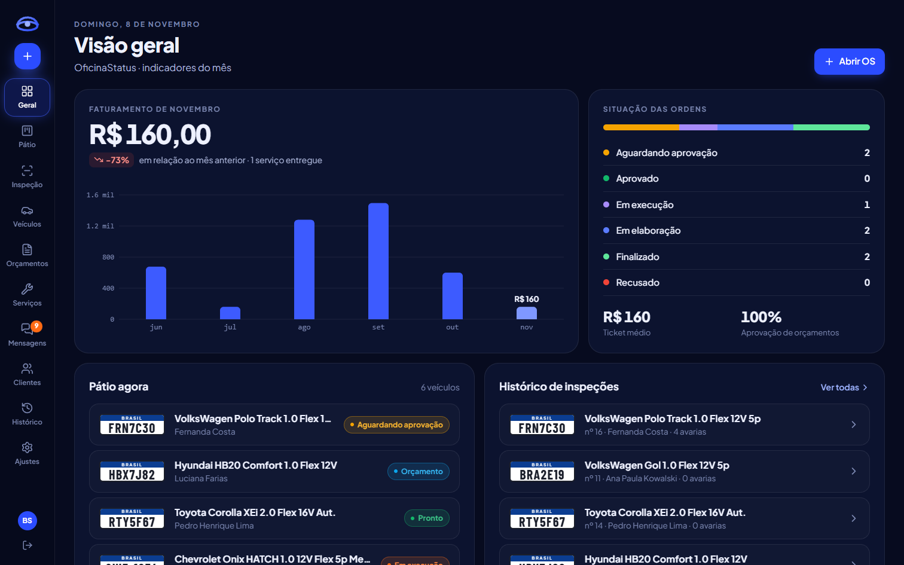
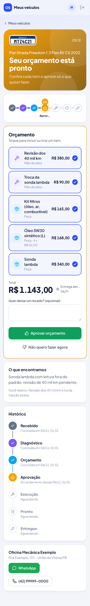
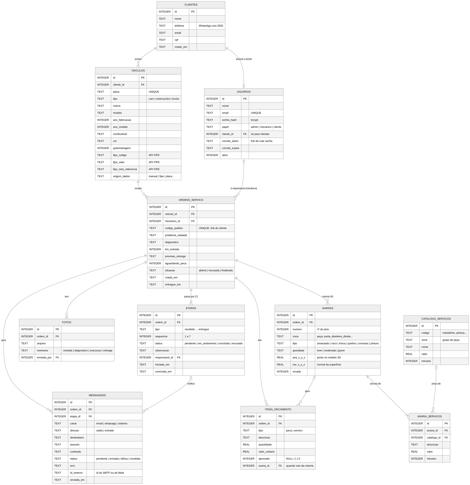

# OficinaStatus

Sistema de acompanhamento de ordens de serviço para oficina mecânica.

**Problema:** os clientes ligam várias vezes para saber do carro.
**Solução:** cada ordem de serviço (OS) passa por 7 etapas, e cada mudança avisa o cliente por e-mail e WhatsApp. O cliente acompanha tudo pelo celular e aprova o orçamento item por item, sem precisar ligar.

**Alunos:** Arthur Svidzinski e Breno Suski

| Área da oficina | Área do cliente (celular) |
|---|---|
|  |  |

## Funcionalidades

**Área da oficina** (administrador e mecânico)
- **Painel** com indicadores em tempo real, faturamento, tempo médio por etapa e serviços mais feitos.
- **Quadro** com cada carro na coluna da sua etapa e a "estrada" de progresso de cada OS.
- **Abertura de OS pela placa:** se o carro já veio antes, aparece na hora. Se for novo, a consulta por placa (PlacaFipe) preenche marca, modelo, ano e cor, e a busca na **API FIPE** traz o valor de referência.
- **7 etapas:** recebido → diagnóstico → orçamento → aprovação → execução (com "aguardando peça") → pronto → entregue. O servidor não deixa pular etapas.
- **Vistoria 3D:** um carro em 3D, modelado no próprio sistema, em que o mecânico clica no ponto danificado. A peça é reconhecida sozinha (porta dianteira direita, capô, farol…). Ele escolhe o tipo de avaria e a gravidade, e o sistema sugere os serviços da tabela de preços, com valor e tempo. **Gerar orçamento** transforma as avarias em itens da OS e, se ela estiver no diagnóstico, já o conclui. O cliente vê o carro com os pontos marcados no portal.
- **Orçamento por itens**, com peças e mão de obra separadas.
- **Mecânico responsável:** cada mecânico vê só as OS dele e as que ainda não têm responsável.
- **Fotos** da entrada, do diagnóstico, da execução e da entrega, tiradas direto pelo celular.
- **Mensagens:** cada envio fica registrado com o status real (enviada, falhou com o motivo, ou aguardando envio manual), com opção de tentar de novo.
- **Equipe e integrações:** convite de mecânicos por link e uma tela com o status de cada serviço externo, com botão de teste.

**Área do cliente**
- Portal com login, que mostra os veículos do cliente, as OS em andamento e o histórico de serviços.
- **Aprovação item por item:** o cliente marca o que quer fazer e vê o total na hora.
- Página de acompanhamento pelo link da mensagem, que funciona sem senha.

## Tecnologias

| Camada | Tecnologia |
|---|---|
| Back-end | Node.js 22+, Express, better-sqlite3, JWT (jsonwebtoken), bcrypt, Nodemailer, Multer |
| Banco de dados | SQLite (`server/data/oficina.db`, criado automaticamente) |
| Front-end | React 19, Vite, Tailwind CSS 4, Motion (animações), Recharts, Lucide, Three.js + React Three Fiber (vistoria 3D) |
| APIs externas | [FIPE da Parallelum](https://github.com/parallelum/fipe-go) · [PlacaFipe](https://doc.placafipe.com.br/api/getplaca.html) · SMTP · WhatsApp Cloud API (Meta) |
| Testes | `node:test`, com servidores SMTP e HTTP locais que recebem as mesmas requisições que os serviços reais |

## Como rodar

Pré-requisito: [Node.js](https://nodejs.org) 22 ou superior (versão LTS).

```bash
npm run instalar                          # instala raiz, servidor e cliente
cp server/.env.example server/.env        # no Windows: copy server\.env.example server\.env
npm run seed                              # opcional: dados de demonstração
npm run dev                               # API em :3333 e site em :5173
```

Abra **http://localhost:5173**.

- **Sem o seed:** a primeira tela pede para criar a conta do administrador.
- **Com o seed (demonstração):** use a senha `oficina123` em todas as contas.
  - Oficina: `admin@oficina.com` (administrador), `arthur@oficina.com` e `rafael@oficina.com` (mecânicos).
  - Clientes: `ana@cliente.com`, `joao@cliente.com` (tem orçamento para aprovar), `marcia@cliente.com`, `luciana@cliente.com` e `fernanda@cliente.com` (OS 16, com vistoria 3D e orçamento gerado pelas avarias).

Para rodar como em produção, com um único servidor entregando a API e o site: `npm run build` e depois `npm start`. Acesse http://localhost:3333 e ajuste `APP_URL` no `.env`.

Testes automatizados: `npm test --prefix server`.

## Configurando as integrações (`server/.env`)

O sistema funciona sem nenhuma integração, mas cada uma liga uma parte real do fluxo. Depois de alterar o `.env`, reinicie o servidor e confira em **Integrações**, no menu da oficina, onde há botões de teste.

### E-mail (Gmail)
1. Ative a verificação em duas etapas na conta Google.
2. Crie uma **senha de app** em [myaccount.google.com/apppasswords](https://myaccount.google.com/apppasswords).
3. Preencha o `.env`:
   ```
   SMTP_HOST=smtp.gmail.com
   SMTP_PORT=587
   SMTP_USER=suaoficina@gmail.com
   SMTP_PASS=a senha de app de 16 letras
   SMTP_FROM=suaoficina@gmail.com
   ```

Com o e-mail ativo, o cliente recebe um aviso a cada etapa. O primeiro aviso já traz o link para ele criar a senha do portal.

### WhatsApp (API oficial da Meta)
1. Em [developers.facebook.com](https://developers.facebook.com), crie um app do tipo *Business* e adicione o produto **WhatsApp**.
2. Em *WhatsApp → API Setup*, copie o **token** e o **Phone number ID**. No modo de teste, cadastre ali os números que vão receber as mensagens.
3. Mensagens iniciadas pela empresa precisam de um **modelo aprovado**. No WhatsApp Manager, crie um modelo da categoria *Utilidade*, em português, chamado `atualizacao_os`, com o corpo:
   ```
   Olá, {{1}}! Atualização do seu veículo: {{2}} Acompanhe por aqui: {{3}}
   ```
4. Preencha o `.env`:
   ```
   WHATSAPP_TOKEN=...
   WHATSAPP_PHONE_NUMBER_ID=...
   WHATSAPP_TEMPLATE=atualizacao_os
   ```

Enquanto o WhatsApp não estiver configurado, cada aviso fica na tela **Mensagens** com o botão "Enviar pelo WhatsApp". Ele abre o WhatsApp Web com o texto pronto para o número do cliente.

### Consulta por placa (PlacaFipe)
A consulta por placa é um serviço pago, porque não existe API oficial gratuita. Contrate um plano em [placafipe.com.br](https://placafipe.com.br) e preencha `PLACA_API_TOKEN=...`. Sem o token, o cadastro usa a busca em cascata da FIPE (marca → modelo → ano), que é gratuita.

### FIPE (Parallelum)
Funciona sem configurar nada, dentro do limite diário gratuito. Para aumentar o limite, use um token do [fipe.online](https://fipe.online) em `FIPE_TOKEN`.

## Estrutura

```
oficinastatus/
├── server/
│   ├── src/
│   │   ├── db.js                 # esquema do banco (8 tabelas)
│   │   ├── config.js             # .env e status das integrações
│   │   ├── app.js                # rotas e tratamento de erros
│   │   ├── seed.js               # dados de demonstração
│   │   ├── routes/               # auth, equipe, clientes, veiculos, ordens, diversos
│   │   └── services/
│   │       ├── ordens.js         # regras das 7 etapas (máquina de estados)
│   │       ├── notificacao.js    # textos de cada aviso
│   │       ├── envio.js          # e-mail (SMTP) e WhatsApp (Meta), com fila
│   │       ├── auth.js           # login, JWT, convites e permissões
│   │       ├── placa.js          # consulta por placa (PlacaFipe)
│   │       ├── fipe.js           # API FIPE (Parallelum) com cache
│   │       └── relatorios.js     # indicadores do painel
│   └── test/                     # fluxo completo e vistoria pela API
├── client/src/
│   ├── acesso/                   # entrar, primeiro acesso, criar senha
│   ├── oficina/                  # painel, quadro, OS, nova OS, cadastros, equipe, integrações
│   ├── cliente/                  # portal, detalhe da OS, página do link
│   ├── vistoria/                 # carro 3D, detecção da peça, painel de avarias
│   ├── ui/                       # placa Mercosul, trilha de etapas, botões, modais, avisos
│   └── lib/                      # API, login, formatos, etapas
└── docs/                         # DER, fluxo de estados e telas
```

## Banco de dados

O banco tem as cinco entidades pedidas (`clientes`, `veiculos`, `ordens_servico`, `etapas`, `mensagens`) e mais `usuarios`, `itens_orcamento`, `fotos`, `avarias`, `avaria_servicos` e `catalogo_servicos` (tabela de preços). Detalhes e cardinalidades estão em [docs/der.md](docs/der.md).



## API

Todas as rotas começam com `/api`. As rotas da oficina e do portal exigem o cabeçalho `Authorization: Bearer <token>`. Em caso de erro, a resposta traz `{ "erro": "mensagem" }`.

| Grupo | Rotas principais | Quem acessa |
|---|---|---|
| Acesso | `POST /auth/login`, `POST /auth/configurar`, `GET /auth/eu`, `GET\|POST /auth/convite/:token`, `POST /auth/esqueci` | todos |
| Ordens | `GET /ordens`, `GET /ordens/:id`, `POST /ordens` | equipe |
| Etapas | `POST /ordens/:id/diagnostico` · `/itens` · `/orcamento/enviar` · `/aprovacao` · `/execucao` · `/peca` · `/pronto` · `/entrega` · `/responsavel` · `/fotos` | equipe |
| Cadastros | `/clientes`, `/clientes/:id/convite`, `/veiculos`, `GET /veiculos/placa/:placa` | equipe |
| FIPE | `GET /fipe/:tipo/marcas[/:marca/modelos[/:modelo/anos[/:ano]]]` | equipe |
| Vistoria 3D | `GET /ordens/:id/avarias/sugestao?zona=&tipo=&gravidade=`, `POST /ordens/:id/avarias`, `PUT\|DELETE /ordens/:id/avarias/:avaria`, `POST /ordens/:id/avarias/orcamento`, `GET /catalogo`, `PUT /catalogo/:id` (admin) | equipe |
| Mensagens | `GET /mensagens`, `POST /mensagens/:id/enviada`, `POST /mensagens/:id/reenviar` | equipe |
| Gestão | `GET /relatorios/painel`, `/equipe`, `GET /integracoes`, `POST /integracoes/teste-email\|teste-whatsapp` | admin |
| Portal | `GET /portal/resumo`, `GET /portal/ordens/:id`, `POST /portal/ordens/:id/resposta` | cliente |
| Link público | `GET /publico/ordens/:codigo`, `POST /publico/ordens/:codigo/resposta` | qualquer um com o link |

O link público usa um código aleatório, não o número da OS. Assim, ninguém consegue ver a OS de outro cliente trocando o número na URL.

## Decisões de projeto

- **Regras no servidor:** a sequência das etapas e as permissões são validadas no back-end, não só na tela.
- **Envio depois do commit:** as mensagens são gravadas na mesma transação da mudança de etapa e enviadas logo em seguida por uma fila. Se o envio falhar, a etapa não se perde, e o erro fica registrado para reenvio.
- **Front-end sem acesso direto às APIs externas:** o servidor guarda os tokens, faz cache da FIPE e padroniza os erros.
