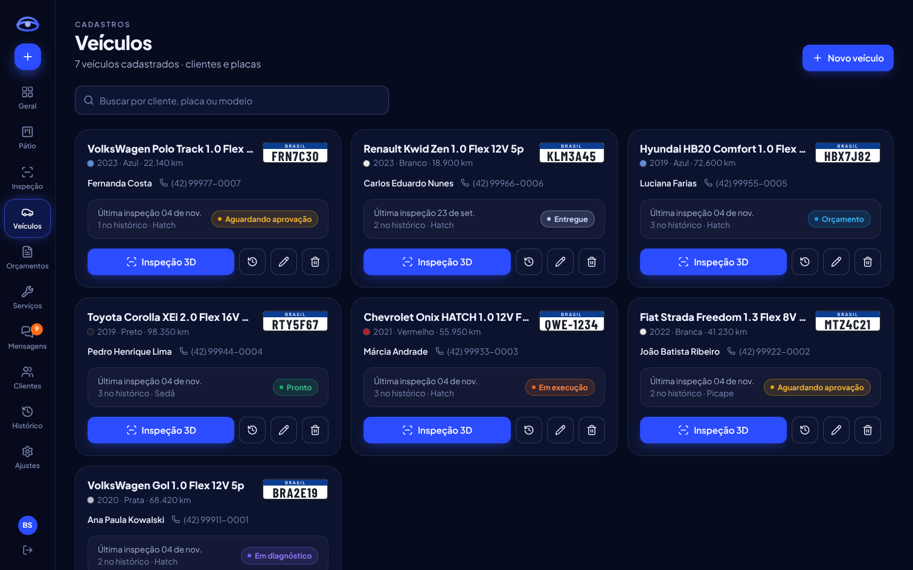

# OficinaStatus

Sistema de acompanhamento de ordens de serviço para oficina mecânica.

**Problema:** os clientes ligam várias vezes para saber do carro.
**Solução:** cada ordem de serviço (OS) passa por 7 etapas, e cada mudança avisa o cliente por e-mail e pelo bot do Telegram. O cliente acompanha tudo pelo celular e aprova o orçamento item por item, sem precisar ligar.

**Alunos:** Arthur Svidzinski e Breno Suski

| Área da oficina | Área do cliente (celular) |
|---|---|
|  |  |

| Visão geral | Veículos | Orçamentos |
|---|---|---|
|  |  |  |

## Funcionalidades

**Área da oficina** (administrador e mecânico, tema escuro com menu lateral)
- **Visão geral** com faturamento do mês comparado ao anterior, situação das ordens, carros no pátio e últimas inspeções.
- **Pátio** com cada carro na coluna da sua etapa e a "estrada" de progresso de cada OS.
- **Inspeção 3D** em tela cheia: modelo do carro conforme a carroceria (hatch, sedã, SUV ou picape) e a cor cadastrada, vistas prontas (perspectiva, topo, laterais, frente, traseira), giro automático, marcadores e destaque das peças avariadas. Clicar numa peça abre o painel dela para **registrar avaria** ou **adicionar serviço sem avaria** (alinhamento, higienização…). O painel mostra o orçamento parcial e a **prévia do que o cliente vai ver**.
- **Veículos** em cartões com a última inspeção, histórico e atalho para a inspeção 3D.
- **Orçamentos** (ORC-ano-número) com filtro por situação, **Serviços** (catálogo de preços por categoria, editável pelo administrador) e **Histórico** de serviços encerrados.
- **Abertura de OS pela placa:** se o carro já veio antes, aparece na hora. Se for novo, a consulta por placa (PlacaFipe) preenche marca, modelo, ano e cor, e a busca na **API FIPE** traz o valor de referência.
- **7 etapas:** recebido → diagnóstico → orçamento → aprovação → execução (com "aguardando peça") → pronto → entregue. O servidor não deixa pular etapas.
- **Como a inspeção funciona:** um carro em 3D, modelado no próprio sistema, em que o mecânico clica no ponto danificado. A peça é reconhecida sozinha (porta dianteira direita, capô, farol…). Ele escolhe o tipo de avaria e a gravidade, e o sistema sugere os serviços da tabela de preços, com valor e tempo. **Gerar orçamento** transforma as avarias em itens da OS e, se ela estiver no diagnóstico, já o conclui. O cliente vê o carro com os pontos marcados no portal.
- **Orçamento por itens**, com peças e mão de obra separadas.
- **Mecânico responsável:** cada mecânico vê só as OS dele e as que ainda não têm responsável.
- **Fotos** da entrada, do diagnóstico, da execução e da entrega, tiradas direto pelo celular.
- **Mensagens:** cada envio e cada resposta ficam registrados com o status real (na fila, enviada, falha com o motivo ou respondida), com opção de tentar de novo.
- **Equipe e integrações:** convite de mecânicos por link e uma tela com o status de cada serviço externo, com botão de teste.

**Área do cliente**
- Portal com login, que mostra os veículos do cliente, as OS em andamento e o histórico de serviços.
- **Aprovação item por item:** o cliente marca o que quer fazer e vê o total na hora.
- Página de acompanhamento pelo link da mensagem, que funciona sem senha.

## Tecnologias

| Camada | Tecnologia |
|---|---|
| Back-end | Node.js 22.13+, Express, node-postgres (pg), JWT (jsonwebtoken), bcrypt, Nodemailer, Multer |
| Banco de dados | PostgreSQL 17, com migrations versionadas em `server/migrations` |
| Ambiente | Docker Compose (aplicação + PostgreSQL) |
| Front-end | React 19, Vite, Tailwind CSS 4, Motion (animações), Recharts, Lucide, Three.js + React Three Fiber (vistoria 3D) |
| APIs externas | [FIPE da Parallelum](https://github.com/parallelum/fipe-go) · [PlacaFipe](https://doc.placafipe.com.br/api/getplaca.html) · SMTP · [Telegram Bot API](https://core.telegram.org/bots/api) |
| Testes | `node:test`, com servidores SMTP e HTTP locais que recebem as mesmas requisições que os serviços reais e um schema descartável do PostgreSQL |

## Como rodar

### Com Docker (ambiente completo)

Pré-requisito: [Docker Desktop](https://www.docker.com/products/docker-desktop/).

```bash
cp server/.env.example server/.env        # no Windows: copy server\.env.example server\.env
docker compose up --build                 # sobe o PostgreSQL e a aplicação e aplica as migrations
docker compose exec app node src/seed.js  # opcional, em outro terminal: dados de demonstração
```

Abra **http://localhost:3333**. Os dados e as fotos ficam em volumes do Docker e continuam lá depois de `docker compose down`. O comando `docker compose down -v` apaga tudo.

### Em desenvolvimento

Pré-requisitos: [Node.js](https://nodejs.org) 22 ou superior (versão LTS) e o Docker Desktop, usado só para o banco.

```bash
npm run instalar                          # instala raiz, servidor e cliente
cp server/.env.example server/.env        # no Windows: copy server\.env.example server\.env
docker compose up -d postgres             # PostgreSQL em localhost:5433
npm run migrate                           # cria ou atualiza as tabelas
npm run seed                              # opcional: apaga os dados e cria a demonstração
npm run dev                               # API em :3333 e site em :5173
```

Abra **http://localhost:5173**. O `npm run dev` e a aplicação do Compose usam a porta 3333, então pare um antes de subir o outro (`docker compose stop app`).

- **Sem o seed:** a primeira tela pede para criar a conta do administrador.
- **Com o seed (demonstração):** use a senha `oficina123` em todas as contas.
  - Oficina: `admin@oficina.com` (administrador), `arthur@oficina.com` e `rafael@oficina.com` (mecânicos).
  - Clientes: `ana@cliente.com`, `joao@cliente.com` (tem orçamento para aprovar), `marcia@cliente.com`, `luciana@cliente.com` e `fernanda@cliente.com` (OS 16, com vistoria 3D e orçamento gerado pelas avarias).

Para rodar sem Docker como em produção, com um único servidor entregando a API e o site: `npm run build`, `npm run migrate` e depois `npm start`. Acesse http://localhost:3333 e ajuste `APP_URL` no `.env`.

Testes automatizados: `npm test --prefix server`, com o PostgreSQL do Compose no ar. Cada arquivo de teste usa um schema próprio, apagado no final, sem tocar nos seus dados. Para usar outro servidor, defina `TEST_DATABASE_URL`.

### Banco de dados e migrations

A conexão vem de `DATABASE_URL` no `server/.env`. Para usar um banco gerenciado na nuvem, troque esse valor pela string de conexão do provedor (em geral com `?sslmode=require`) e rode `npm run migrate`. Como proteção, o `npm run seed` só apaga um banco remoto com `npm run seed -- --forcar`.

Para mudar o esquema, crie um novo arquivo numerado em `server/migrations`, como `002_nova_coluna.sql`, e rode `npm run migrate`. Cada arquivo roda uma vez, em ordem, e fica registrado na tabela `schema_migrations`. Não edite uma migration já aplicada: o comando recusa o arquivo alterado. O servidor não sobe se houver migrations pendentes.

### Modelo 3D do Golf (opcional)

Na inspeção 3D, os hatches da Volkswagen usam o modelo [**Volkswagen Golf GTI (2025)**](https://sketchfab.com/3d-models/volkswagen-golf-gti-2025-84fe6c2b9feb4c8a854d16f3daf33eab), de [geyges](https://sketchfab.com/geyges), no Sketchfab. A licença Free Standard do Sketchfab proíbe redistribuir o arquivo, por isso `client/public/modelos/golf.glb` está no `.gitignore` e não vem com o repositório. Sem ele, o sistema funciona normalmente e esses veículos aparecem com o carro desenhado, como todos os outros.

Para usar o modelo na sua máquina:

1. Com uma conta no Sketchfab, abra a [página do modelo](https://sketchfab.com/3d-models/volkswagen-golf-gti-2025-84fe6c2b9feb4c8a854d16f3daf33eab) e baixe-o no formato original.
2. Extraia o `.zip`. O arquivo usado é `source/golf_gti_my25_lights_on.glb`.
3. Depois de `npm run instalar`, gere a versão otimizada:

   ```bash
   node client/scripts/otimizar-golf.mjs caminho/para/golf_gti_my25_lights_on.glb
   ```

O script simplifica e comprime o modelo (de cerca de 18 MB para 2,3 MB), separa as peças para o clique da inspeção e grava `client/public/modelos/golf.glb`. Para rodar sem Docker como em produção, gere o arquivo antes do `npm run build`. A imagem do Docker não inclui o modelo, por causa da licença: nela, esses veículos aparecem com o carro desenhado.

## Configurando as integrações (`server/.env`)

O sistema funciona sem nenhuma integração, mas cada uma liga uma parte real do fluxo. Depois de alterar o `.env`, reinicie o servidor e confira em **Integrações**, no menu da oficina, onde há botões de teste.

### E-mail (Gmail)
1. Ative a verificação em duas etapas na conta Google.
2. Crie uma **senha de app** em [myaccount.google.com/apppasswords](https://myaccount.google.com/apppasswords).
3. Preencha o `.env`:
   ```
   SMTP_HOST=smtp.gmail.com
   SMTP_PORT=587
   SMTP_USER=suaoficina@gmail.com
   SMTP_PASS=a senha de app de 16 letras
   SMTP_FROM=suaoficina@gmail.com
   ```

Com o e-mail ativo, o cliente recebe um aviso a cada etapa. O primeiro aviso já traz o link para ele criar a senha do portal.

### Telegram (bot)
O bot avisa o cliente a cada etapa e pede a aprovação do orçamento com os botões **Aprovar** e **Recusar**. Sem o token, o sistema continua funcionando e as mensagens ficam na fila até o bot ser configurado.

1. No Telegram, abra o [@BotFather](https://t.me/BotFather), envie `/newbot` e siga as instruções. Ele devolve o **token** e o **nome** do bot, que termina em `bot`.
2. Preencha o `.env`. O segredo é um texto longo que você inventa (só A-Z, a-z, 0-9, `_` e `-`):
   ```
   TELEGRAM_TOKEN=...
   TELEGRAM_BOT_USERNAME=nome_do_seu_bot
   TELEGRAM_WEBHOOK_SECRET=...
   ```
3. Com o servidor no ar (`npm run dev`), em outro terminal:
   ```bash
   npm run webhook
   ```
   O comando sobe um túnel do [cloudflared](https://developers.cloudflare.com/cloudflare-one/connections/connect-networks/) e registra a URL no Telegram com `setWebhook`. O túnel expõe só a porta `WEBHOOK_PORT` (3334), que atende apenas o webhook. A URL muda a cada execução, e o comando registra a nova. Em produção, sem túnel: `npm run webhook -- --url https://seu-dominio`.

#### Como funciona
- **Vínculo (opt-in):** o bot só fala com quem iniciou a conversa. O botão **Telegram**, no cadastro do cliente, e **Vincular Telegram**, no portal, geram o link `https://t.me/BOT?start=codigo`, que vale por 7 dias e uma única vez. Ao tocar em Iniciar, o `chat_id` é gravado em `canais_usuario`.
- **Envio:** cada aviso é gravado como `enfileirada` e enviado com `sendMessage` depois do commit. O `message_id` vai para `id_externo`, e o status passa a `enviada`. Cliente sem vínculo fica com `falha` e o motivo; depois de vincular, **Tentar de novo** envia.
- **Orçamento:** os botões aprovam todos os itens ou recusam a OS, marcam a mensagem como `respondida` e chamam `answerCallbackQuery`. Só a mensagem mais recente vale: se o orçamento mudar, os botões antigos deixam de valer. Para aprovar só parte dos itens, o cliente usa o link da mensagem.
- **Webhook `POST /webhook/telegram`:** confere o cabeçalho `X-Telegram-Bot-Api-Secret-Token` (401 se não conferir), responde 200 antes de processar e ignora `update_id` repetido. Toda mensagem e todo clique recebidos ficam em `mensagens`, com o `payload_bruto`.
- **Erros:** no 429, o envio espera o `retry_after` e tenta de novo; erros temporários usam backoff, até 5 tentativas. No 403 (o cliente bloqueou o bot), o vínculo é desativado. A descrição e o código do erro aparecem na tela **Mensagens**.

O Telegram não informa "entregue" nem "lida". O ciclo de cada mensagem é `enfileirada` → `enviada` ou `falha` → `respondida`, esta quando o cliente clica em um botão ou responde à mensagem do bot.

### Consulta por placa (PlacaFipe)
A consulta por placa é um serviço pago, porque não existe API oficial gratuita. Contrate um plano em [placafipe.com.br](https://placafipe.com.br) e preencha `PLACA_API_TOKEN=...`. Sem o token, o cadastro usa a busca em cascata da FIPE (marca → modelo → ano), que é gratuita.

### FIPE (Parallelum)
Funciona sem configurar nada, dentro do limite diário gratuito. Para aumentar o limite, use um token do [fipe.online](https://fipe.online) em `FIPE_TOKEN`.

## Estrutura

```
oficinastatus/
├── server/
│   ├── migrations/               # esquema do banco em arquivos SQL numerados
│   ├── src/
│   │   ├── db.js                 # conexão com o PostgreSQL e transações
│   │   ├── migrar.js             # aplica as migrations (npm run migrate)
│   │   ├── config.js             # .env e status das integrações
│   │   ├── app.js                # rotas e tratamento de erros
│   │   ├── seed.js               # dados de demonstração
│   │   ├── routes/               # auth, equipe, clientes, veiculos, ordens, diversos
│   │   └── services/
│   │       ├── ordens.js         # regras das 7 etapas (máquina de estados)
│   │       ├── notificacao.js    # textos de cada aviso
│   │       ├── envio.js          # e-mail (SMTP) e Telegram, com fila e backoff
│   │       ├── telegram.js       # cliente da Bot API
│   │       ├── botTelegram.js    # /start, mensagens recebidas e botões do webhook
│   │       ├── canais.js         # vínculo (opt-in) pelo deep link
│   │       ├── auth.js           # login, JWT, convites e permissões
│   │       ├── placa.js          # consulta por placa (PlacaFipe)
│   │       ├── fipe.js           # API FIPE (Parallelum) com cache
│   │       └── relatorios.js     # indicadores do painel
│   ├── scripts/webhook.js        # npm run webhook: túnel + setWebhook
│   └── test/                     # fluxo completo, vistoria, Telegram e PostgreSQL pela API
├── client/src/
│   ├── acesso/                   # entrar, primeiro acesso, criar senha
│   ├── oficina/                  # painel, quadro, OS, nova OS, cadastros, equipe, integrações
│   ├── cliente/                  # portal, detalhe da OS, página do link
│   ├── vistoria/                 # carro 3D, detecção da peça, painel de avarias
│   ├── ui/                       # placa Mercosul, trilha de etapas, botões, modais, avisos
│   └── lib/                      # API, login, formatos, etapas
├── docs/                         # DER, fluxo de estados e telas
├── Dockerfile                    # imagem da aplicação (site + API)
└── docker-compose.yml            # aplicação + PostgreSQL
```

## Banco de dados

O banco tem as cinco entidades pedidas (`clientes`, `veiculos`, `ordens_servico`, `etapas`, `mensagens`) e mais `canais_usuario`, `comunicacoes` (e-mails e registros do sistema), `usuarios`, `itens_orcamento`, `fotos`, `avarias`, `avaria_servicos` e `catalogo_servicos` (tabela de preços). Detalhes e cardinalidades estão em [docs/der.md](docs/der.md).


## API

Todas as rotas começam com `/api`. As rotas da oficina e do portal exigem o cabeçalho `Authorization: Bearer <token>`. Em caso de erro, a resposta traz `{ "erro": "mensagem" }`.

| Grupo | Rotas principais | Quem acessa |
|---|---|---|
| Acesso | `POST /auth/login`, `POST /auth/configurar`, `GET /auth/eu`, `GET\|POST /auth/convite/:token`, `POST /auth/esqueci` | todos |
| Ordens | `GET /ordens`, `GET /ordens/:id`, `POST /ordens` | equipe |
| Etapas | `POST /ordens/:id/diagnostico` · `/itens` · `/orcamento/enviar` · `/aprovacao` · `/execucao` · `/peca` · `/pronto` · `/entrega` · `/responsavel` · `/fotos` | equipe |
| Cadastros | `/clientes`, `/clientes/:id/convite`, `/clientes/:id/telegram`, `/veiculos`, `GET /veiculos/placa/:placa` | equipe |
| FIPE | `GET /fipe/:tipo/marcas[/:marca/modelos[/:modelo/anos[/:ano]]]` | equipe |
| Vistoria 3D | `GET /ordens/:id/avarias/sugestao?zona=&tipo=&gravidade=`, `POST /ordens/:id/avarias`, `PUT\|DELETE /ordens/:id/avarias/:avaria`, `POST /ordens/:id/avarias/orcamento`, `GET /catalogo`, `PUT /catalogo/:id` (admin) | equipe |
| Mensagens | `GET /mensagens`, `POST /mensagens/telegram\|email/:id/reenviar` | equipe |
| Gestão | `GET /relatorios/painel`, `/equipe`, `GET /integracoes`, `POST /integracoes/teste-email\|teste-telegram`, `POST /integracoes/telegram/vinculo` | admin |
| Webhook (fora de `/api`) | `POST /webhook/telegram` | Telegram (cabeçalho com o segredo) |
| Portal | `GET /portal/resumo`, `GET /portal/ordens/:id`, `POST /portal/ordens/:id/resposta`, `POST /portal/telegram` | cliente |
| Link público | `GET /publico/ordens/:codigo`, `POST /publico/ordens/:codigo/resposta` | qualquer um com o link |

O link público usa um código aleatório, não o número da OS. Assim, ninguém consegue ver a OS de outro cliente trocando o número na URL.

## Decisões de projeto

- **Regras no servidor:** a sequência das etapas e as permissões são validadas no back-end, não só na tela.
- **Envio depois do commit:** as mensagens são gravadas na mesma transação da mudança de etapa e só entram na fila de envio depois do commit. Se a transação for desfeita, nada é enviado. Se o envio falhar, a etapa não se perde, e o erro fica registrado para reenvio.
- **Transações em série:** uma trava do PostgreSQL (`pg_advisory_xact_lock`) faz as transações de escrita rodarem uma de cada vez. Assim, dois pedidos simultâneos não abrem duas OS para o mesmo veículo nem avançam a mesma etapa duas vezes.
- **Front-end sem acesso direto às APIs externas:** o servidor guarda os tokens, faz cache da FIPE e padroniza os erros.
