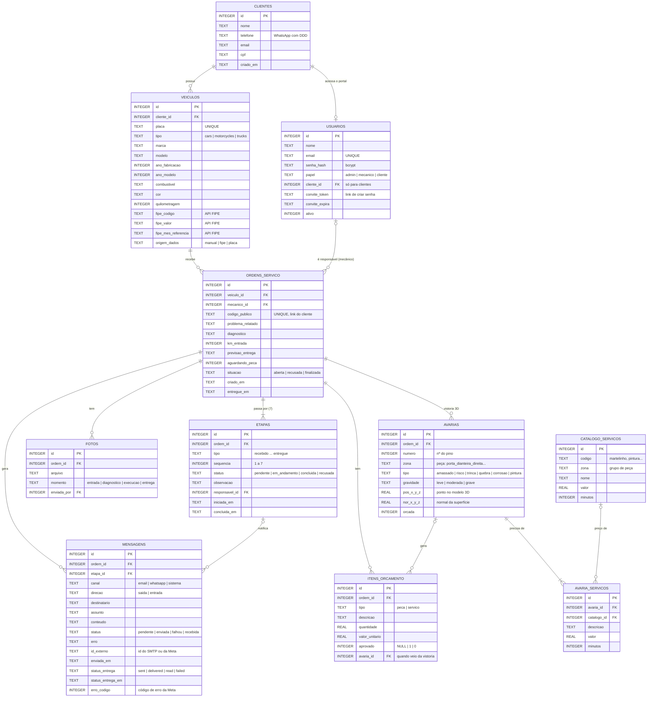
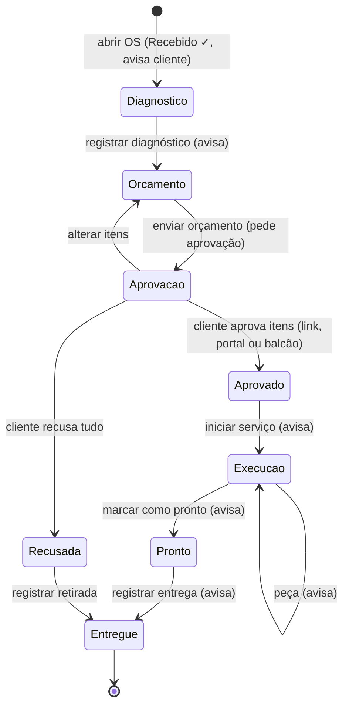

# Diagrama Entidade-Relacionamento — OficinaStatus

Versões em imagem para o relatório: [der.png](der.png) e [fluxo-estados.png](fluxo-estados.png).
O GitHub também renderiza os diagramas abaixo diretamente a partir do código Mermaid.

As cinco entidades exigidas (`clientes`, `veiculos`, `ordens_servico`, `etapas`, `mensagens`) estão presentes. As tabelas extras dão suporte ao login (`usuarios`), ao orçamento por itens (`itens_orcamento`), às fotos (`fotos`) e à vistoria 3D (`avarias`, `avaria_servicos` e `catalogo_servicos`).

## Cardinalidades

| Relação | Cardinalidade | Regra |
|---|---|---|
| Cliente → Veículos | 1 : N | Excluir o cliente exclui os veículos (`ON DELETE CASCADE`). |
| Cliente → Usuário | 1 : 0..1 | Clientes com e-mail ganham uma conta para o portal. |
| Veículo → Ordens de serviço | 1 : N | Só **uma OS aberta por veículo** (regra na aplicação). |
| Usuário (mecânico) → Ordens | 0..1 : N | Mecânico vê só as OS dele e as sem responsável. |
| Ordem → Etapas | 1 : 7 | Toda OS nasce com as 7 etapas; `UNIQUE (ordem_id, tipo)`. |
| Ordem → Itens de orçamento | 1 : N | O cliente aprova item por item. |
| Ordem → Mensagens | 1 : N | Cada mudança de etapa gera uma mensagem por canal; o envio real fica registrado (`status`, `erro`, `id_externo`). |

## Fluxo de estados da OS

