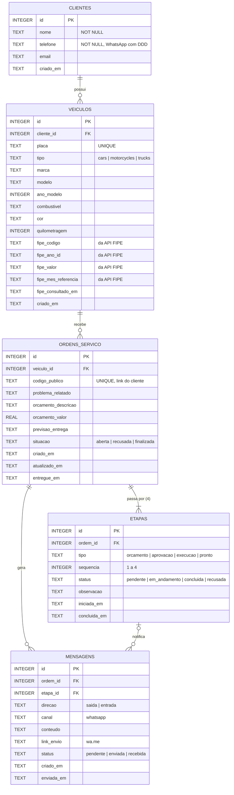
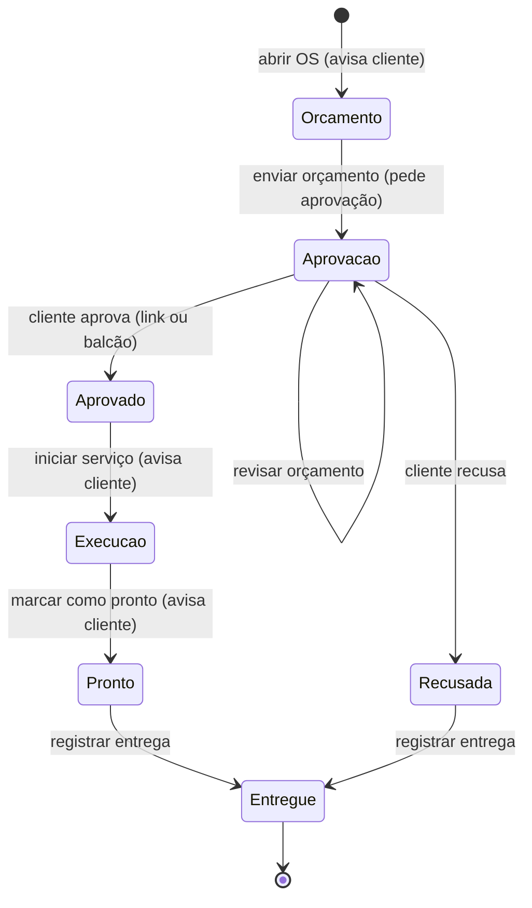

# Diagrama Entidade-Relacionamento — OficinaStatus

Versões em imagem para o relatório: [der.png](der.png) e [fluxo-estados.png](fluxo-estados.png).
O GitHub também renderiza os diagramas abaixo diretamente a partir do código Mermaid.

## Cardinalidades

| Relação | Cardinalidade | Regra |
|---|---|---|
| Cliente → Veículos | 1 : N | Um cliente pode ter vários veículos; excluir o cliente exclui os veículos (`ON DELETE CASCADE`). |
| Veículo → Ordens de serviço | 1 : N | Um veículo tem histórico de OS, mas só **uma OS aberta por vez** (regra na aplicação). |
| Ordem de serviço → Etapas | 1 : 4 | Toda OS é criada com as 4 etapas; `UNIQUE (ordem_id, tipo)`. |
| Ordem de serviço → Mensagens | 1 : N | Cada mudança de etapa gera uma mensagem de saída; a resposta do cliente gera uma de entrada. |
| Etapa → Mensagens | 0..1 : N | A mensagem guarda qual etapa a originou (`ON DELETE SET NULL`). |

## Fluxo de estados da OS

